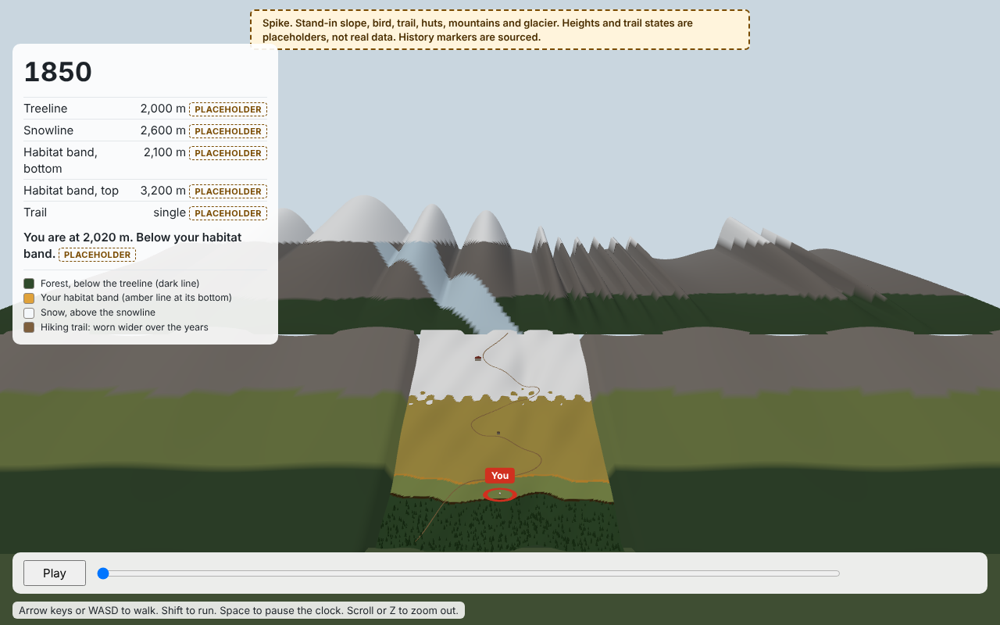
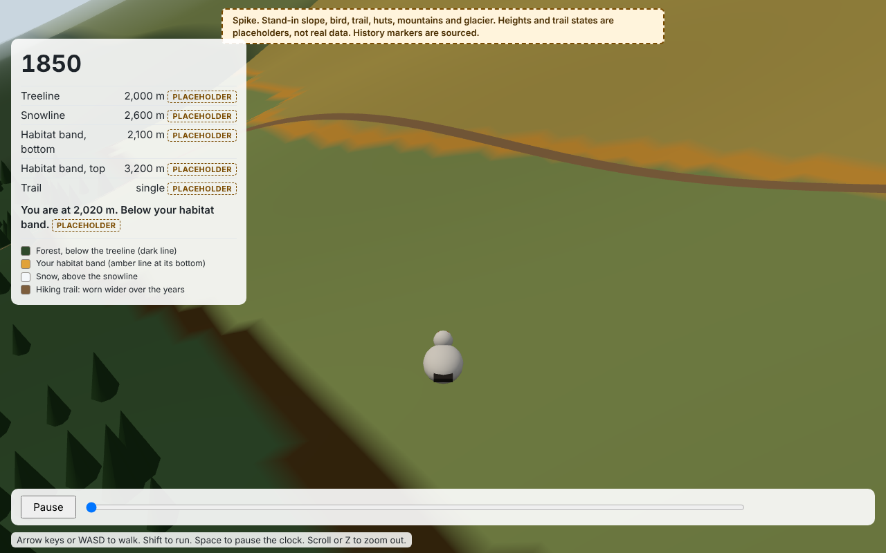
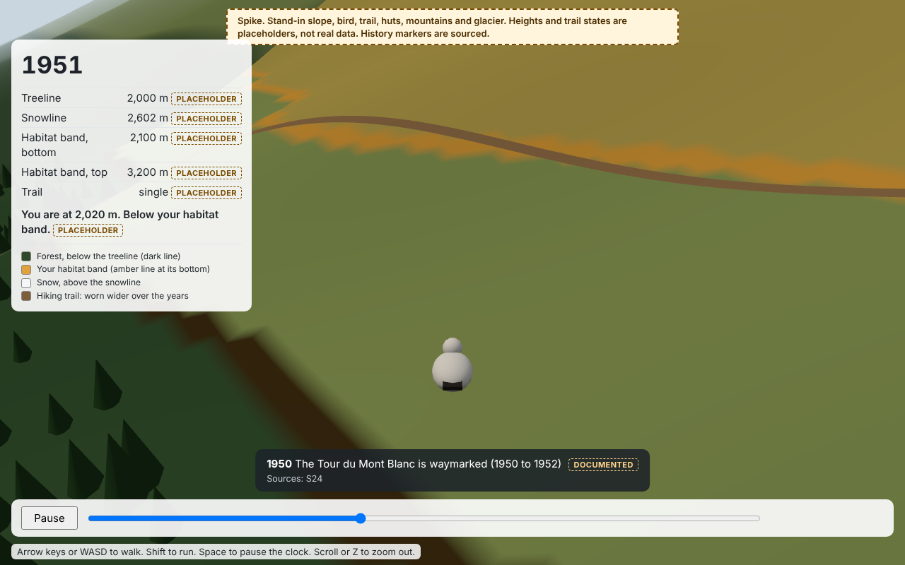
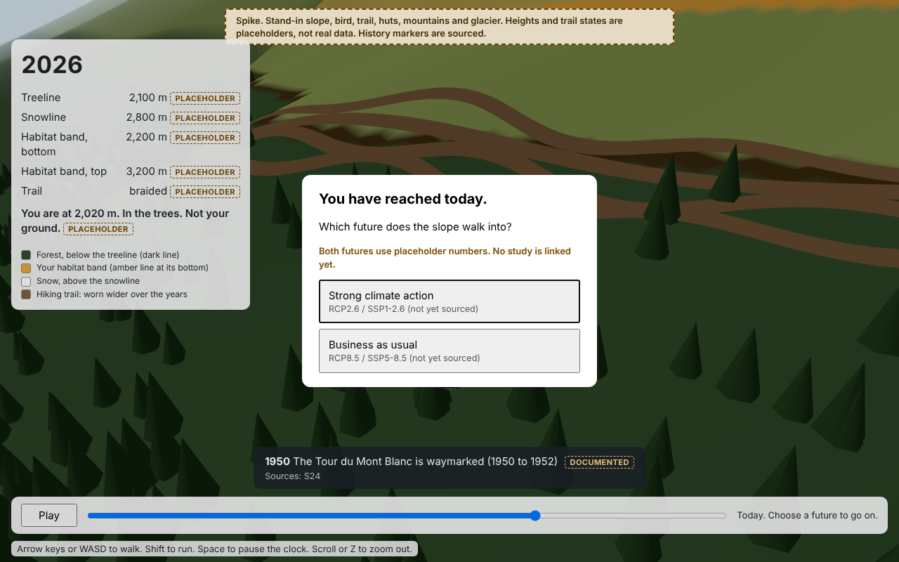
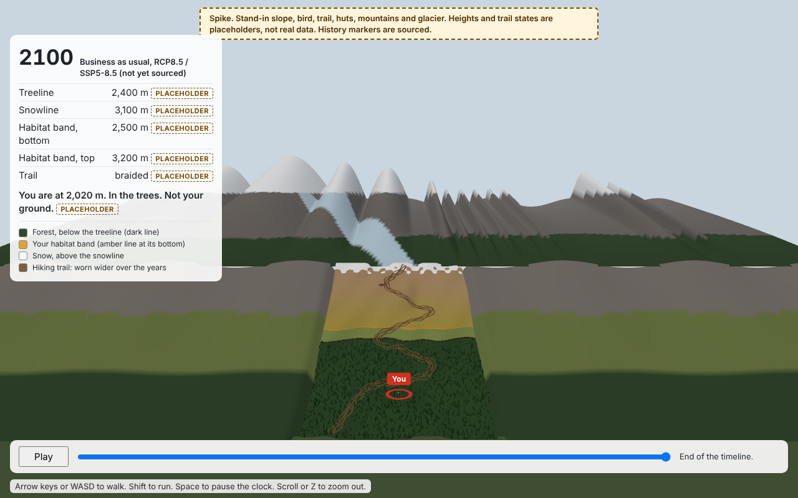
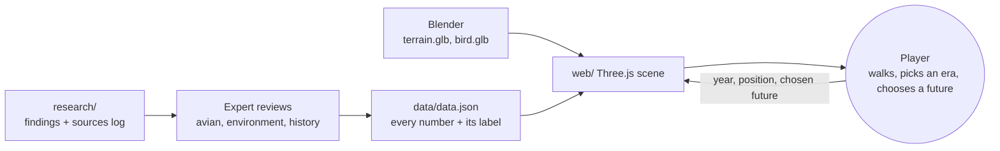

# Ptarmigan

You are a rock ptarmigan above Chamonix, living through what people and a warming climate do to your ground from 1850 to 2100.

Process page for the Hello World final project (SVA MFA Interaction Design, Fall 2026). Milestone: proposal and spike, November 23. Next: prototype Nov 30, dry run Dec 7, final presentation Dec 14.

> Parts marked **Caitlin:** are mine to write. Everything else is drafted from the project files and checked against them.

---

## 1. Proposal

### One-sentence core
You walk one slope as a ptarmigan while 250 years pass, and you feel your ground shrink and change because of what people build, abandon and warm.

### The idea
An explorable 3D world at Col de Balme, a high pass at the head of the Chamonix valley, with the Mont Blanc massif and its glaciers rising beside it (draft setting). Where a record comes from somewhere nearby rather than the pass itself, the scene names the place. You are the bird. A clock runs from 1850, when the Mer de Glace was at its Little Ice Age maximum, to 2100. As it runs, the treeline climbs, snow arrives later and leaves sooner, the glacier beside you pulls back, and people leave their marks: herders' huts and walls, then trails, refuges, crowds of hikers and tents. The main story is human impact (land use, trails, refuges, thru-hiking) together with climate change. The first UTMB in 2003 is called out along the way, as the moment the race arrives on these trails.

### Why this matters to me
As someone who has lived in mountainous places and been fortunate enough to visit places like Mont Blanc, I have begun to notice the changes in the natural world and how we as humans have directly contributed to them. I decided to focus on the Chamonix Valley because it is a very special place for me. I've never felt the level of awe I felt staring up at that towering giant. I have been fortunate enough to visit several times: a surprise first visit in 2019, hiking the Tour du Mont Blanc (TMB) in 2024, and racing OCC in 2025. The valley has felt the rise in popularity of both of those. I see them as things any endurance athlete and lover of the natural world should experience, but I also recognize my own contribution to the degradation of this special place.

My vision is an immersive experience of how the valley has changed over time, for natural and human-caused reasons. In my research I found alarming numbers for the rock ptarmigan. CREA Mont-Blanc projects the bird could lose about 60% of its habitat in the massif by 2050 and over 90% by 2090 (S1). The birds are already declining: the Contamines-Montjoie nature reserve, where the TMB crosses the Col du Bonhomme, reports a marked decline since its counts began in 2008, with 41 adults and no broods in 2025, compared with 5 broods in 2022 (S18). Nearby, in the Italian Alps about 100 km east of Mont Blanc, calling males fell from 7.52 to 2.63 per km² between 1997 and 2012 (Imperio et al. 2013, S46). I focus on that bird in this exploration. I have created agents to help me understand the history, environment and environmental impacts of the area, and I have tasked agents to help me build the experience in Blender and Three.js.

### Who it is for
- Runners of the UTMB
- Hikers of the TMB
- Skiers, including those who do routes like the Haute Route
- Also anyone, to bring awareness

Why: so we can recognize our impact and visualize the changes we've caused through our own action and inaction.

### Who can help test it
- Experience: classmates at the Nov 30 and Dec 7 crits, and runner friends.
- Facts: no outside experts this term. Facts are checked against published sources (checker agent, `reviews/checks/`). The expert agents are research personas, not real validation, so this stays a known limit.

### Core experience (sequence)
| # | Moment | What you see and do |
|---|---|---|
| 0 | Opening | The view starts wide: the whole Mont Blanc massif seen from the Chamonix valley. It zooms in to one slope and one bird. At any point you can zoom back out to see the whole massif, then return to the bird. The spike has a stand-in version with a code-made range; real terrain comes with the prototype. |
| 1 | 1850 | You arrive as the bird on wide open alpine ground below the massif, with the glacier right beside you, long and close. Snow lies late. Herders' huts and stone walls below. |
| 2 | Living there | You walk your territory and do the bird's daily tasks. Which tasks: to be decided for the prototype (candidates: feeding, snow roosting, raising a brood), each checked against sources. |
| 3 | Time runs | The clock moves at 5 years per minute. Pastures empty and the forest climbs. Trails and refuges appear, then more feet and tents. Instead of scrubbing, you choose a starting era, and the clock carries on from there (draft for the prototype; the spike still has a year slider). |
| 4 | 2003 | The first UTMB passes below. A callout marks the race's arrival: runners now circle the massif every summer. |
| 5 | Today (2026) | The clock pauses. You choose the future: **strong climate action** or **business as usual**. |
| 6 | The future | Climate follows the projection for the path you chose, labeled with its emissions pathway. On the action path, land care (repaired trails, booked refuges, protected ground) is shown as "a possible future", not a forecast. |
| 7 | 2100 | To be decided once the daily tasks are designed. |

People never appear as figures, only as their traces (huts, walls, paths, tents, refuges).

### Storyboard (from the spike)
Screenshots of the spike scene, in order. Everything shown is a stand-in: code-made slope, bird and mountains, and placeholder heights. The history markers are sourced.

| | |
|---|---|
|  | **1. Opening, 1850.** A wide view of the range with your slope below the glacier. A red marker shows where you are, then the camera glides down to the bird. |
|  | **2. You are the bird, 1850.** Forest below you, your habitat band (amber) above, a single narrow trail. |
|  | **3. People arrive, 1951.** History markers appear as the clock passes, here the Tour du Mont Blanc being waymarked (S24). |
|  | **4. Today, 2026.** The trees have reached you and the trail is braided. The clock stops: you choose a future. |
|  | **5. 2100, business as usual.** Pulled back to the whole range: forest has climbed over your old ground and the band has shrunk toward the top. |

### How the world tells you what is real
Every value in the scene carries one of these labels, and the viewer can see which is which.

| Label | Meaning |
|---|---|
| measured | Observed in a published record |
| reconstructed | Rebuilt by scientists from tree rings, old maps, paintings or texts (study named) |
| projected | From a climate model, with emissions pathway and study named |
| scenario | A hopeful land-use future built from real precedents, shown as "a possible future" |
| placeholder | A stand-in while building |
| missing | Not found yet, shown as unknown |

---

## 2. Scope and plan

### Priorities (draft, Caitlin to re-rank)
| Priority | Item |
|---|---|
| Must | The 2003 UTMB callout; walkable bird on real terrain; a running clock from 1850 to 2100 with a choice of starting era; daily tasks that get harder over time (feed, roost in snow, raise a brood; draft); treeline, snow and habitat band driven by `data/data.json`; the choice at today; every value labeled |
| Should | A temperature inversion (a sea of cloud filling the valleys) to hide the edges of the world (draft, from Caitlin's spike notes); opening zoom and zoom-out on real Mont Blanc terrain seen from the Chamonix valley (prototype, Nov 30; the spike has a stand-in version); human traces that change over time (huts, walls, trails, refuges, tents); glacier front; short text markers for key events; stylized bird with a walk cycle |
| Nice | Sound; seasons and weather; ptarmigan molt; validation by CREA Mont-Blanc |

### Stopping point
The core loop works end to end at the pass: walk, do the daily tasks, the clock runs, you choose at today, and treeline, snow and habitat change from real labeled data. Anything after that is craft, not new features.

### One possible cut
Human traces become a few fixed props that switch on by year, instead of trails that wear and recover.

### Components map

| Part | Tool | Data or state | Who |
|---|---|---|---|
| Terrain, props, bird | Blender, glTF | `world/exports/terrain.glb`, `bird.glb` | world-builder agent, Caitlin approves |
| Every number the scene uses | JSON | `data/data.json` (format in `data/README.md`) | data-scientist agent |
| Scene, walking, camera, clock, choice | Three.js | current year, bird position, chosen future, clock running or paused | engine-developer agent |
| Facts and sources | Markdown | `research/findings/`, `research/sources-log.md` | researcher agent; avian, environmental and historian agents review |
| Checks | Markdown | `reviews/` | checker and code-reviewer agents |

### Source provenance
Every number comes from a logged source (51 so far in `research/sources-log.md`) or is marked `missing`. Main sources:

| Layer | Source | Years |
|---|---|---|
| Glaciers | Mer de Glace and Bossons reconstructions (Nussbaumer et al.), WGMS records | 1570 to 2024 |
| Snow | Juniper ring reconstruction (Carrer et al. 2023), CREA Mont-Blanc snow season | 1400 to about 2018 |
| Temperature | HISTALP | 1760 on |
| Treeline | CREA Mont-Blanc (about +60 m since the 1950s) | 1950s to 2017 |
| Ptarmigan | CREA projection, Swiss elevation studies, Imperio et al. 2013 | about 1984 to 2090 |
| Futures | Dumont et al. 2025, Verfaillie et al. 2018 (emissions pathways named) | to 2100 |
| Land use and trails | Trail restoration reports, TMB history, refuge history, reservation news | 1740s to 2026 |

Known gaps: no published treeline or habitat reconstruction for Mont Blanc before the 1950s. The CREA ptarmigan projection names no emissions pathway, so the bird's strong-action future is `missing` for now. Treeline rise is partly people leaving the pastures, not climate alone.

### Resource needs
- Terrain: Copernicus DEM GLO-30, downloaded on my Mac (blocked from the cloud workspace). The zoom-out needs terrain for the whole massif and valley, not just the slope: a coarse wide model plus a detailed slope.
- Blender and a browser. No paid services.
- **Caitlin:** anything else (time, help, hardware).

---

## 3. Small experiment (spike)

Full record: [`docs/spike.md`](docs/spike.md)

| | |
|---|---|
| Question | Does walking a ptarmigan through a shrinking world feel more personal than seeing the same change on a chart? |
| Why this is the riskiest unknown | The whole project rests on embodiment doing something a chart cannot. If it doesn't, a data visualization would be the better form. |
| Prediction (written before trying) | I actualyl had no idea it was going to make a scene. But had I known that, I had an image of a much more flat slope with the mountaibns rising above it. I expected it below the glacier. I expected there to be trails built and things like refuges appearing. |
| Setup | Three.js scene with a stand-in slope and bird, keyboard walking, and a clock from 1850 to 2100 (5 years per minute, scrubbable, choice at 2026) that moves treeline, snow and the habitat band. An opening glide and a zoom-out (scroll or Z) show a code-made, labeled stand-in Mont Blanc range with the slope below a glacier. A first human-impact layer: a trail that goes single, widened, braided, or restored (as "a possible future"), a stand-in herder's hut and refuge with no people, and sourced history markers (1821, 1852, 1860, 1901, 1950 to 1952, 2027 planned). All values are placeholders, labeled on screen. Only the checker agent ran (labels and placeholders): passed with no blockers, report in `reviews/checks/2026-11-23.md`. |
| Actual result | surprise of something being already interactive. The scene above was very weird to me - i have no idea what is receeding. The edge of the world runoff was also strange. |
| Prediction, round 2 (zoom-out and human layer, written before trying) | I predict a view across the valley - and as time passes and you zoom out you can also see those changes. Well. I don't predict but thats what i am envisioning eventually. After the first render i saw I don't expect anything detailed - i did not give it any reference images and we will do the real world building in Blender. I expect the bird to move the same as before and the trees to be the same. I hope to see paths and refuges appear as we talked about before. |
| Actual result, round 2 | better than expected! Definitely needs some work but i liked the points in history along the way. It is still very steep but better. |
| What it did and did not establish | The spike did show a visible change. It's slow enough if you are in the experience but I think the timeline being so obvious makes you just want to scrub it rather than experience it - so I would want that to be a less obvious interaction. |
| Next decision | Yeah flattening the slope is a big one I'd like to see - where he's more on a top of a pass with the mountain rising further beside him. The change needs to be more realistic. And I would like to consider little tasks for the ptarmagin in the experience (or daily things they do) and how the changes make those tasks harder and harder as time passes. |
| Still uncertain | clarity: it was a strange color choice so i wasn't sure what the spike was trying to show as receeding. pacing: I want it to be an experience you get into as a bird but the changes to be subtle terrain: flatter is easier to view on a screen but also better to create a scene. realism: that gets better with changes we will make in blender and three.js so i am not worried. tasks: we will see if that matters. I have to see it and interact with it to have an opinion on that. data vs view: we will see! Worlds edge: I think a good way around this is an inversion, which the region is known for! |

---

## 4. Handoff

### Source and version
- Repo: https://github.com/cstandifer/ptarmigan. This version is tagged `hello-world-week10` (proposal and spike, 2026-11-23): https://github.com/cstandifer/ptarmigan/tree/hello-world-week10
- Plain files, no build step: `web/index.html` plus `web/src/*.js` (one job per file). Three.js 0.160.0, pinned from jsDelivr through an import map.
- Data: `data/data.json` in spike mode. Every value is `placeholder` with round numbers and the note "spike stand-in". `habitat_share` is left `missing` on purpose. The shape for the two futures is in `data/methods.md`.

### How to run the spike
1. In Terminal: `cd ~/Desktop/ptarmigan`
2. Run `python3 -m http.server 8000`
3. Open http://localhost:8000/web/ in Chrome or Safari. It must be served this way because it loads `data.json`. It needs internet on every load, for Three.js.
4. Press Control+C in Terminal to stop.

| Control | Does |
|---|---|
| Arrows or WASD | Walk |
| Shift | Run |
| Space | Pause or resume the clock |
| Slider | Jump to any year; the clock continues from there |
| Mouse wheel or Z | Zoom out to the wide view and back |

The clock runs 5 years per minute, pauses at 2026 for "Strong climate action" or "Business as usual", and stops at 2100. Full file map and what was tested: `web/README.md`. Checker report: `reviews/checks/2026-11-23.md`.

### How to inspect
| To see | Open |
|---|---|
| Every number and its label | `data/data.json`, format in `data/README.md` and `data/methods.md` (includes `trail_condition` and `events`) |
| Where each fact came from | `research/sources-log.md` |
| Research and expert reviews | `research/findings/`, `research/reviews/` |
| Rules every agent follows | `CLAUDE.md` |

### Human roles
- **Caitlin Standifer:** director. Owns the story, the look, the voice and every approval. Writes the prediction, observations and personal sections. Approves at three gates (data in, world blockout, each playable build).
- Real-world fact checking (for example CREA Mont-Blanc in Chamonix) is a human step. Not planned this term for lack of time; a known limit.

### Support needs
**Caitlin:** Catching blind spots on what I am designing. I have reviewers and agents, but am I missing anything? Are there ways to prompt the design to make it more efficient and accurate the first time around? And to make all changes after that cleaner, so any human could look at them and understand the changes I ask for?

### AI role and credits
AI helps develop the software and research. It does not run inside the experience.

- **Claude (Anthropic)** via Claude Code: planning, research, writing drafts of docs and code.
- Nine agents defined in `.claude/agents/`: researcher, avian-expert, environmental-scientist, historian, data-scientist, world-builder, engine-developer, checker, code-reviewer. The expert agents are **research personas, not real experts**. Their reviews are not expert validation.
- Agents propose and build. Creative decisions and approvals are mine.

### Source credits
All sources, links, access dates and licenses: `research/sources-log.md`. Papers are cited for facts and numbers only; no text is copied. Conceptual reference: James Bridle, *Ways of Being* (2022).

Code library: Three.js 0.160.0 (MIT license). In the spike, treeline, snow and habitat values are placeholders; the history markers are sourced (see `research/sources-log.md`).

### Privacy check (initial)
- Runs locally and collects nothing: no personal data, no accounts, no tracking.
- No real people appear; humans are shown only through traces.

### Accessibility check (initial)
- Keyboard only, no mouse needed. Space pauses the clock.
- Status is shown in words (a dashed PLACEHOLDER tag), not color alone.
- An on-screen banner says the slope, the bird and all numbers are stand-ins. A legend explains the labels, the bird's height line carries a status tag, and the future choice says both futures are placeholders with no study yet.
- Not yet done: screen reader narration of the world, a reduced-motion setting, color contrast testing. On phone widths the panel covers the banner.

---

## Using this folder with Claude Code
1. Open this folder in Claude Code. It reads `CLAUDE.md` automatically.
2. The agents in `.claude/agents/` are available by name. Ask for one directly, for example:
   - "Use the researcher to find the ptarmigan's elevation range on Mont Blanc."
   - "Have the avian expert review today's findings."
   - "Run the checker and code reviewer before I approve this build."
3. Approve at the three gates in `CLAUDE.md` before work moves on.

| Folder | What |
|---|---|
| `docs/` | Spike write-up, proposed edits, handoffs |
| `research/` | Findings, expert reviews, sources log |
| `data/` | `data.json` and its format |
| `world/` | Blender files and exports |
| `web/` | The Three.js scene |
| `reviews/` | Checker and code reviewer reports |
